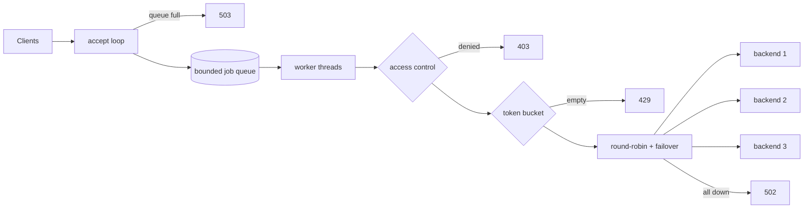

# Multithreaded HTTP Reverse Proxy

A reverse proxy written from scratch in C++17 using POSIX sockets. It sits in front of a set of backend servers and decides, for every request, whether to **allow, block, or throttle** it before load-balancing it to a healthy backend.

**Features**
- **Thread pool** with a bounded job queue; sheds load with `503` when overloaded
- **Round-robin load balancing** with automatic **failover** to the next backend
- **Per-client token-bucket rate limiting** (`429` + `Retry-After`)
- **IP access control** with CIDR allow/deny rules and default-deny policy (`403`)
- **Correct proxy semantics**: strips hop-by-hop headers, adds `X-Forwarded-For`
- **Hardening**: socket timeouts against slow clients, header size limit (`431`), `SIGPIPE` handling
- Config file, Docker image, Docker Compose setup, end-to-end tests and a `wrk` benchmark

## Architecture



Checks run cheapest-first: a blocked or throttled client is rejected before the proxy reads its request or opens a backend connection.

| File | Responsibility |
|---|---|
| `src/proxy.cpp` | Sockets, HTTP request reading/rewriting, request pipeline |
| `src/thread_pool.h` | Fixed workers + bounded queue (mutex + condition variable) |
| `src/load_balancer.h` | Lock-free round-robin using `std::atomic` |
| `src/rate_limiter.h` | Token bucket per client IP, lazily refilled |
| `src/access_control.h` | CIDR parsing and allow/deny matching |
| `src/config.h` | `key = value` config file parser with validation |

## Quick start

Requires Linux, macOS or WSL, `g++` (C++17), `make`, `python3`.

```bash
make
# start three test backends
python3 backend/server.py 9001 & python3 backend/server.py 9002 & python3 backend/server.py 9003 &
./proxy config/proxy.conf

curl localhost:8080/hello         # rotates across backends
make test                         # run the end-to-end test suite
```

**With Docker**
```bash
docker compose up --build
curl localhost:8080/
```

## Configuration

```ini
listen_port = 8080
threads = 8
max_queue = 1024
timeout_sec = 5
rate_limit_capacity = 20          # burst size per client (0 disables)
rate_limit_refill_per_sec = 10    # sustained rate per client
backend = 127.0.0.1:9001          # repeatable
allow = 10.0.0.0/8                # repeatable; any allow rule => default-deny
deny = 10.0.0.66/32               # repeatable; deny always wins
```

## Tests

`make test` starts real backends and proxies and checks behaviour with `curl`:

```
Forwarding        GET, POST body, X-Forwarded-For
Load balancing    30 requests split exactly 10/10/10 across 3 backends
Failover          dead backend skipped; all backends dead -> 502
Rate limiting     burst of 8 with capacity 5 -> 5x200, 3x429; refills over time
Access control    denied CIDR -> 403
Concurrency       50 parallel requests all succeed
12 passed, 0 failed
```

The proxy was also run under **ThreadSanitizer** with ~84,000 requests (including ~79,000 concurrent rate-limiter hits) and reported **no data races**.

## Benchmark

`./bench/benchmark.sh` — `wrk`, 100 concurrent connections, 3 Python backends, rate limiting off, 2-vCPU Linux VM:

| Worker threads | Requests/sec | p50 | p99 | Errors |
|---|---|---|---|---|
| 1 | 2,275 | ~44 ms | 66 ms | 0 |
| 8 | **4,368** | **22 ms** | **35 ms** | 0 |

Moving from one worker to a pool of eight gave **1.9× throughput** and **47% lower p99 latency**. At this point the single-threaded Python test backends are the bottleneck, not the proxy.

## Design decisions

- **Bounded queue + 503** rather than an unbounded queue: under overload, failing fast is better than accepting work that will time out anyway and exhausting memory.
- **Lazy token refill**: tokens are topped up from elapsed time when a request arrives, so there is no background timer thread. `steady_clock` is used so system clock changes can't break limits.
- **Atomic round-robin counter**: `fetch_add` picks the next backend without a mutex on the hot path.
- **`Connection: close` to backends**: the end of a response is simply the backend closing the socket, which avoids parsing chunked responses.
- **Socket timeouts**: without them, a client that connects and sends nothing (Slowloris) pins a worker thread forever.

## Limitations and next steps

- One request per client connection (no HTTP keep-alive); no chunked *request* bodies
- Blocking I/O with a thread pool; an `epoll`-based event loop would scale to far more idle connections
- IPv4 only; no TLS termination
- Passive failover only; active health checks would avoid retrying a known-dead backend
- Rate-limiter buckets are never evicted; an LRU or periodic sweep would bound memory
